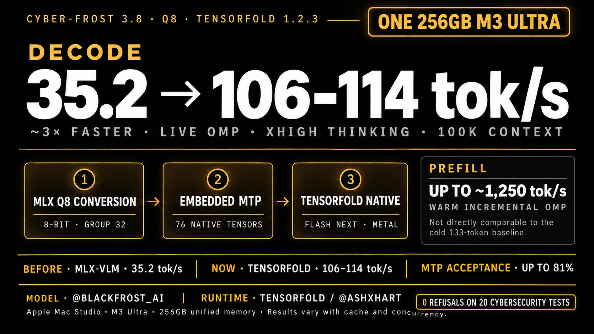

# Cyber-Frost Qwen3.8 Flash Next — MLX Q8 + TensorFold

Reproducible conversion, native-MTP packaging, TensorFold serving, and Oh My Pi (OMP) configuration for the Qwen3.8 Flash Next–based [Blackfrost-AI/CYBER-FROST-3.8-BF16](https://huggingface.co/Blackfrost-AI/CYBER-FROST-3.8-BF16) checkpoint on Apple Silicon.



## What landed

- MLX affine 8-bit conversion, global group size 32
- 41 base SafeTensors shards plus 76 embedded native MTP tensors
- Native TensorFold 1.2.3 recognition as `Qwen3.8 Flash Next (qwen4_exp)`
- OpenAI-compatible local endpoint with tool calling and reasoning effort
- 100K configured context in OMP
- 106–114 generated tokens/s in clean live OMP requests on a 256GB M3 Ultra
- Up to 81% observed MTP draft acceptance
- 0 refusals on a local 20-prompt cybersecurity behavior screen

The converted weights are published separately on Hugging Face:

[`choppedgarlic/CYBER-FROST-Qwen3.8-Flash-Next-TensorFold-MLX-8bit`](https://huggingface.co/choppedgarlic/CYBER-FROST-Qwen3.8-Flash-Next-TensorFold-MLX-8bit)

## Hardware and tested software

| Component | Tested configuration |
| --- | --- |
| Inference host | Mac Studio, Apple M3 Ultra, 256GB unified memory |
| Conversion host | MacBook Pro, Apple M2 Max, 96GB unified memory |
| TensorFold | Native 1.2.3 |
| MLX-VLM converter | 0.7.12 |
| MLX | 0.32.4 |
| OMP | 18.16.0 |
| Checkpoint | 188.96 GiB / 202,892,816,404 bytes |
| Context configured | 100,000 tokens |

## Install TensorFold

TensorFold is a separate project by [@ashxhart](https://x.com/ashxhart). On Apple Silicon:

```bash
brew tap ashhart/tensorfold
brew install ashhart/tensorfold/tensorfold
/opt/homebrew/bin/tensorfold --version
```

Use the native Homebrew binary explicitly if an older Python `tensorfold` command shadows it in `PATH`.

## Download the model

```bash
brew install huggingface-cli
hf download \
  choppedgarlic/CYBER-FROST-Qwen3.8-Flash-Next-TensorFold-MLX-8bit \
  --local-dir "$HOME/models/CYBER-FROST-Qwen3.8-Flash-Next-TensorFold-MLX-8bit"
```

The weights require about 189 GiB of disk. TensorFold 1.2.3 reported a conservative 217.99 GiB startup budget for this checkpoint; leave additional headroom for macOS and applications.

## Serve with TensorFold

```bash
./scripts/serve-tensorfold.sh \
  "$HOME/models/CYBER-FROST-Qwen3.8-Flash-Next-TensorFold-MLX-8bit"
```

The tested launch profile is equivalent to:

```bash
FLASHNEXT_LOAD_LIMIT_GB=240 /opt/homebrew/bin/tensorfold serve \
  "$HOME/models/CYBER-FROST-Qwen3.8-Flash-Next-TensorFold-MLX-8bit" \
  --context 100000 \
  --max-tokens 8192 \
  --temperature 0 \
  --thinking \
  --reasoning-effort xhigh \
  --port 18080 \
  --name cyberfrost \
  --no-update-check
```

This profile is intentionally tuned for the tested 256GB M3 Ultra. Reduce `FLASHNEXT_LOAD_LIMIT_GB`, context, or output budget on smaller systems.

## Smoke test the endpoint

With the server running:

```bash
./scripts/smoke-test.sh
```

The endpoint is OpenAI-compatible on the wire, but the model and inference are local: Cyber-Frost weights served by TensorFold, not an OpenAI-hosted model.

## Use it in Oh My Pi

Merge [`examples/omp-models.yml`](examples/omp-models.yml) into `~/.omp/agent/models.yml` and the role mapping in [`examples/omp-config.yml`](examples/omp-config.yml) into `~/.omp/agent/config.yml`. Start TensorFold first, then launch OMP.

The OMP provider uses:

- provider/model: `cyberfrost/cyberfrost`
- endpoint: `http://127.0.0.1:18080/v1`
- 100K context and 8K maximum output
- tool support enabled
- reasoning efforts `low`, `medium`, `high`, and `xhigh`
- no cloud fallback in the included role example

## Performance

See [`RESULTS.md`](RESULTS.md) for the complete run notes and comparability warnings.

| Path | Prompt/prefill | Decode |
| --- | ---: | ---: |
| MLX-VLM Q8 baseline, cold 133-token prompt | 18.212 tok/s | 35.237 tok/s |
| TensorFold native MTP, clean live OMP requests | warm incremental sections up to ~1,250 tok/s | 105.8–114.0 tok/s |

The decode result is roughly 3× the matched model's earlier MLX-VLM baseline. The prefill figures are not an apples-to-apples comparison: the TensorFold numbers are warm, incremental, and cache-assisted, while the old 18.212 tok/s measurement was a short cold prompt.

Concurrent OMP helper requests can reduce per-request decode to roughly 73–77 tok/s because requests queue and share the machine.

## Conversion and MTP packaging

The source checkpoint was pinned at revision `3e30d25ddb0e802389d62e55e9ff31ad05f0c96e` and converted with MLX-VLM 0.7.12 / MLX 0.32.4. The initial converter emitted the base and MTP sidecar separately. [`tools/embed_tensorfold_mtp.py`](tools/embed_tensorfold_mtp.py) rewrites the 76 MTP tensor names under `language_model.mtp.*`, adds `model-mtp.safetensors`, and updates the weight index without modifying the 41 base shards.

Read [`PLAN.md`](PLAN.md) for the complete conversion history and [`RESULTS.md`](RESULTS.md) for structural validation and benchmark records.

## Evaluation boundaries

- The 20 cybersecurity prompts were a local refusal/behavior screen, not a standardized capability or safety benchmark.
- `0 refusals` does not mean every answer was correct, safe, or operationally useful.
- No direct BF16-vs-Q8 quality comparison was possible on the 256GB machine because the BF16 checkpoint is roughly 335 GiB.
- Performance varies with prompt length, cache state, concurrency, thermal state, output length, and TensorFold version.
- The source model card states that text is the validated modality; do not infer validated image/video quality from included processor files.

## Credits and license

- Model: [Blackfrost-AI/CYBER-FROST-3.8-BF16](https://huggingface.co/Blackfrost-AI/CYBER-FROST-3.8-BF16), `@Blackfrost_AI`
- Runtime: [TensorFold](https://github.com/ashhart/TensorFold), `@ashxhart`
- Qwen3.8 Flash Next architecture and upstream license: Qwen

The model weights are governed by the Qwen Community License 1.0; review [`MODEL-LICENSE`](MODEL-LICENSE) before use. Repository scripts and documentation are released under the MIT license in [`LICENSE`](LICENSE).
